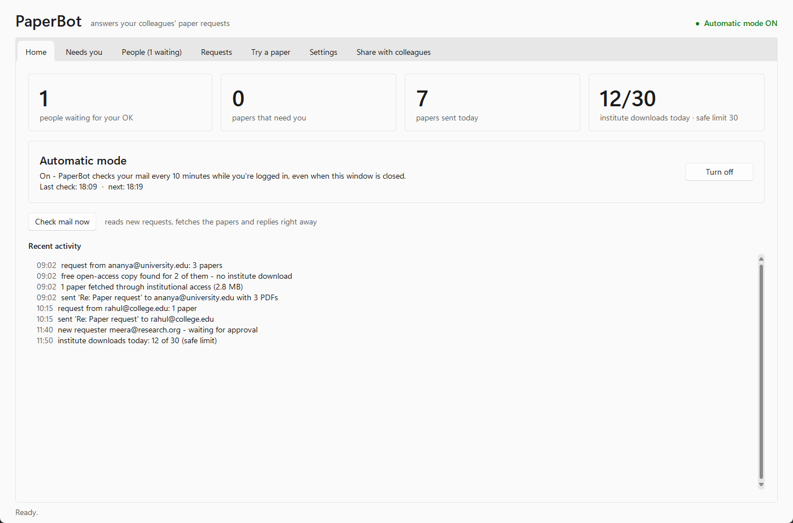
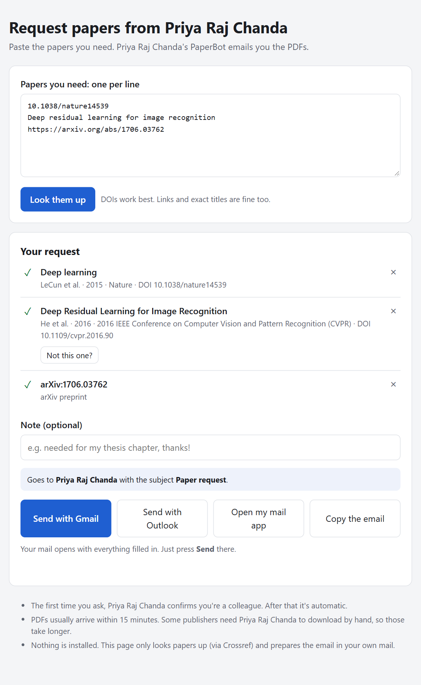
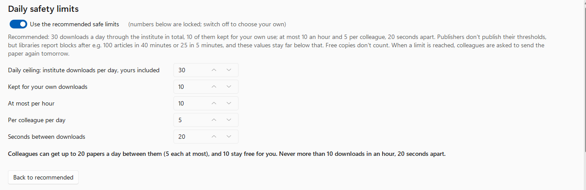

# PaperBot

PaperBot answers colleagues' requests for research papers by email. It reads a mailbox,
works out which paper each person wants, finds the PDF and replies with it attached, in the
same thread. It tries free open-access copies first. Only when there is none does it use your
institution's access (a Windows VPN connection), and then within daily fair-use limits.

There are two parts, and neither needs the command line:

| who | app | what they do |
|---|---|---|
| The person with institutional access | **PaperBot** desktop app (Windows) | set it up, approve new people, handle the few papers that need a human, turn automatic mode on |
| Colleagues who need papers | **Request page**: one HTML file, opened in any browser | paste DOIs, links or titles, confirm the right paper, press *Send with Gmail / Outlook* |

<p>
  
  
</p>

## How a request is handled

```
email "Paper request"  ─►  new person?  ── yes ──►  you approve (in the app, or reply "yes")
                               │ no
                               ▼
        identify the paper (Crossref / arXiv / Semantic Scholar)
                               ▼
        free published copy? ── yes ──►  download (no institutional access used)
                               │ no
                               ▼
        VPN on ─► publisher site in Edge/Chrome ─► VPN off (only if PaperBot turned it on)
                               │ still nothing
                               ▼
        author's manuscript (clearly labelled), or "Needs you"
                               ▼
        reply with the PDFs + a line for anything not sent
```

- **Request formats.** The subject must contain "paper request". The body has one DOI, link,
  arXiv id or exact title per line. The request page writes this email for people.
- **First-time requesters** wait for your OK: press *Approve* in the app, or reply "yes" to the
  email PaperBot sends you. Approval can be switched off, and whole email domains can be
  trusted.
- **Papers that need a person.** Some publishers block automated browsers or show "verify you
  are human" checks. PaperBot never tries to get around them. The paper goes to *Needs you* and
  the requester is told it will come separately. One click there opens it in an ordinary,
  non-automated browser window, routed through your institutional access. You download the PDF
  and PaperBot emails it on.

## Daily safety limits (fair use)



Publishers don't publish their thresholds for "systematic downloading". Libraries report blocks
after, for example:

- [100 articles in 40 minutes](https://www.kulib.kyoto-u.ac.jp/bulletin/10612?lang=en);
- [25 accesses in 5 minutes](https://www.kulib.kyoto-u.ac.jp/modules/erdb/ej/excessive_use_flier_en.pdf);
- a [proposed cap of 100 a day](https://tagteam.harvard.edu/hub_feeds/2038/feed_items/276676).

Such blocks usually hit the whole institution, for
[an hour to several days](https://webarchive.library.unt.edu/web/20090505194734/http://nihlibrary.nih.gov/Features/downloading.htm).
PaperBot's recommended defaults stay far below all of these:

| limit | default |
|---|---|
| Downloads through institutional access per day (everyone, the account holder included) | 30 |
| …of which kept for the account holder's own use | 10 |
| Per hour | 10 |
| Per requester per day | 5 |
| Gap between downloads | 20 s |

- **When a limit is reached**, the requester's reply says *"today's download limit has been
  reached - please send this one again tomorrow"* for that paper. Free open-access copies don't
  count toward the limits and are still sent.
- **Changing the limits.** They live in Settings, and the recommended values are on by default.
  The app warns when custom values are higher than recommended.

Respect your institution's licence terms. Most licences allow sending a single article to a
colleague for research, and forbid systematic downloading and sharing outside the institution.

## Install (Windows 10/11)

You need:
- Python 3.10+ from [python.org](https://www.python.org/downloads/)
- Microsoft Edge or Google Chrome
- a Gmail / Google Workspace mailbox with an [app password](https://myaccount.google.com/apppasswords)
- optionally, a Windows VPN connection that gives you institutional access

Steps:
1. Download this repository (*Code → Download ZIP*) and unzip it, or `git clone` it.
2. Double-click **`Install PaperBot.cmd`**. It creates a private Python environment, adds
   *PaperBot* to the Desktop and Start menu, and opens the app.
3. **Settings:**
   - Fill in your name and the mailbox colleagues write to.
   - Set the mail app password. It's stored in Windows Credential Manager, never in a file.
   - Pick your VPN connection, which uses the password Windows saved for it.
   - Press **Check everything**.
4. **Home.** Turn on **Automatic mode**. PaperBot then checks mail 1 minute after you sign in to
   Windows and every 10 minutes after that, even with its window closed.
5. **Share with colleagues** saves the request page to send them. It can also save an installer
   zip for colleagues who have institutional access of their own.

## Notes from testing

- **Publishers.**
  - Fetched automatically: Nature, Springer, arXiv, and open-access copies anywhere.
  - Block automated browsers, so they go to *Needs you*: IEEE Xplore, ScienceDirect,
    Taylor & Francis and Oxford Academic.
- **VPN quirks handled:**
  - `rasdial` ignores sign-ins saved in Windows Settings, so PaperBot dials with them directly.
  - Windows can keep routing traffic around a fresh VPN for 10+ seconds, so PaperBot waits until
    traffic really goes through it.
  - IPv4-only VPNs would let IPv6 traffic bypass them, so PaperBot's browsers go through a
    built-in IPv4-only relay. The relay also refuses private and intranet addresses.
- **Security.**
  - Approval replies only count from your own address, and only with a secret reference code.
  - Replies go to the sender's From address, never Reply-To.
  - Mail that fails DMARC is ignored.

## Command line and development

Everything is also available as `paperbot <command>` (`paperbot -h`). The scheduled task runs
`pythonw -m paperbot run`.

```
.venv\Scripts\python -m pytest                                  # tests: fakes only, no mail, no VPN
.venv\Scripts\python scripts\gui_screenshots.py out [--dark]    # app screenshots on demo data
```

## License

PaperBot is free to use, change and share under the [MIT License](LICENSE).

Made by Priya Raj Chanda.
